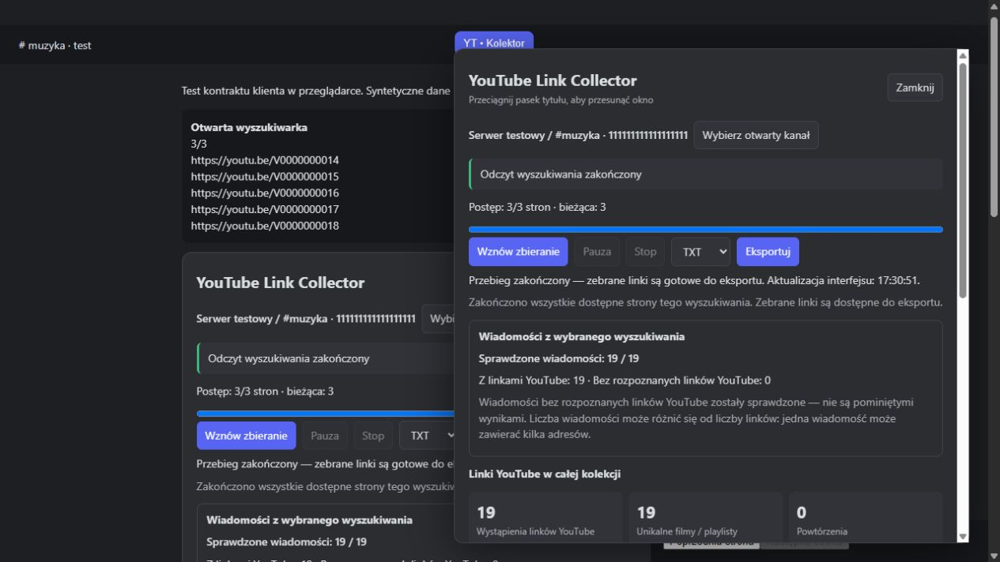

# YouTube Link Collector 1.2.6 — resume and live diagnosis

Author: **ProGraMajster**. Date: **2026-10-16**. Local prerelease candidate.

The 1.2.5 automatic action always initialized a navigator that rewound to page 1. Its separate Resume control restarted local reading without creating a navigator. After an error this looked like a broken resume or unexpected restart. In 1.2.6 the primary action resumes automatic collection from the page actually open, rereads that page, and proceeds forward. Mode/export format persist in optional schema-1 checkpoint fields; old navigation checkpoints infer automatic mode. Starting over is a separate confirmed action, and switching to a new search scope is explicit.

The main panel separates automatic collection, Pause/Stop and export from advanced manual reading. Channel selection is visible. Progress, active phase, last-check/progress age, interface heartbeat and pacing countdown show what is happening. A separate load/read timeout defaults to 90 seconds and accepts 15–300 seconds. Pause/Stop cancel pending work immediately; a delivered client click may finish loading.

Incomplete React hit objects are resolved by their exact page-provided ID against complete client-store records or committed mounted message props. An incomplete MessageStore record no longer shadows a complete SearchMessageStore record. The adapter does not append an accumulated store or accept DOM text as proof of a full message. A genuine 24/25 page still cannot advance. The historical fault on a different computer is not proven to have this exact cause; the sanitized unresolved reason counters support future diagnosis.

If a page changes during pacing before any click, bounded rechecks stabilize and recapture the same page. The completed pacing interval is retained for that page. Three consecutive unstable rechecks stop; a successfully delivered click is never retried automatically. Existing scope, count, ID, loading, checkpoint and cancellation guards remain.

The actual client is now observable through an optional expiring read-only file connection. No debugger port, commands, evaluator, user token or private Discord endpoint is involved. Fresh native responses identified the current 1.2.6 plugin and recognized the search/React/store/pagination contracts, first at 25/25 messages and later at the final page with 23/23. The user confirmed forward continuation after Pause/Resume and successful re-enable of the final installed copy. A fresh final-build response showed page 6/6, full 23/23 results, activity finished and no current error. This is distinct from synthetic browser tests and does not establish a native 50-page run, the cause of the friend's intermittent failure, full channel-history coverage or a physical export save. [Connection protocol](LIVE-DIAGNOSTICS.md).

Validation: **185/185 Node tests**, zero failures/skips, syntax/packaging/network-boundary checks for 13 JavaScript files and both HTML fixtures. Browser fixtures: **12/12 resume checks** beginning from a synthetic page-19/50 checkpoint, including Pause/Resume and preservation of pages 1–18; **11/11 normal navigation/export checks** with a full 19-link TXT and verified existing UI clicks. Current error/partial-read, checkpoint roundtrip, alternate-bank recovery, lifecycle cleanup and callback exports remain covered.

Local installation is performed only with a fresh diagnostic response showing no active scan. Private plugin/config backups precede atomic replacement; configuration bytes are unchanged by the installer. Current collection and full JSON roundtrip counts are checked on private copies, never published. The GitHub prerelease remains 1.2.5; this work does not create a commit, tag, push or new public release.

