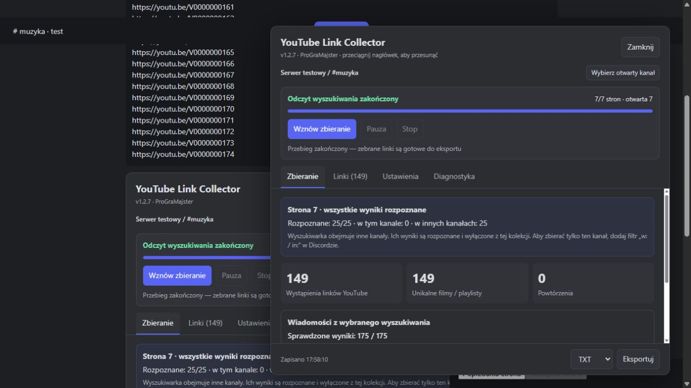

# YouTube Link Collector 1.2.7 — live-client repair and panel redesign

Author: **ProGraMajster**. Implementation and native validation: **2026-10-16**. Release preparation: **2026-10-17**. Prerelease.

The native client stalled on page 6 at 24/25. The previous diagnostic called the last hit missing-in-store. A fresh bounded shape report demonstrated that it was a complete message with a different channel ID. The stored search had no selected-channel filter. The collector only imports the selected channel, so rejecting that hit as missing caused a false timeout. Version 1.2.7 qualifies these other-channel hits as explicit exclusions. They contribute to page identity, stabilization and reviewed-result accounting, while their content/links are not imported into the selected-channel collection. Genuine missing or incomplete hits remain blocking. Pages consisting only of foreign hits can also advance. Optional excluded IDs are validated, budgeted and preserved in schema-1 page evidence.

The user confirmed page 6→7, with native diagnostics later observing continued forward progress. The UI then stayed frozen while collection continued. Reopening repainted it once. BetterDiscord reuses the same instance on disable/enable: stop cancelled the pending render timer but retained its truthy handle, so renderSoon permanently treated a refresh as pending. A replay of the installed pre-fix code reproduced zero subsequent refreshes. Stop now nulls that handle. The regression exercises three disable/enable cycles and repeated refreshes. Detached settings nodes retain registration, and one panel's render exception cannot freeze the other or leave Stop disabled. Sanitized diagnostics report last successful panel age and error type/source line.

The redesigned window has four tabs: Zbieranie, Linki, Ustawienia and Diagnostyka. Collection controls/status and export stay visible, with one scrolling content body. Current-page counts distinguish selected-channel, foreign-channel and truly unavailable results. Keyboard tab navigation, dragging, search, deduplication modes, full exports, pacing and recovery reuse the existing controllers.

All 194 Node tests passed with zero skips/failures. Browser checks passed 12/12 after same-instance re-enable and 7/7 for mixed/all-foreign pages. A 520×680 layout check found no horizontal overflow and retained the export footer. The user confirmed that final native counters/countdown update without reopening. Final installation occurred only after a fresh paused response; a private backup and JSON roundtrip preserved 1168 occurrences / 1167 unique resources / one duplicate, with configuration bytes unchanged. A native full 97-page run, physical export completion and full channel-history coverage are not claimed.

The project author remains ProGraMajster; MIT and schema 1 are retained. Version 1.2.7 is prepared for publication through the existing tag-triggered Release workflow, after the complete CI matrix succeeds for the release commit. Published assets are independently downloaded and checked against the tag and SHA-256 manifests. Previous validation remains available as historical evidence.

