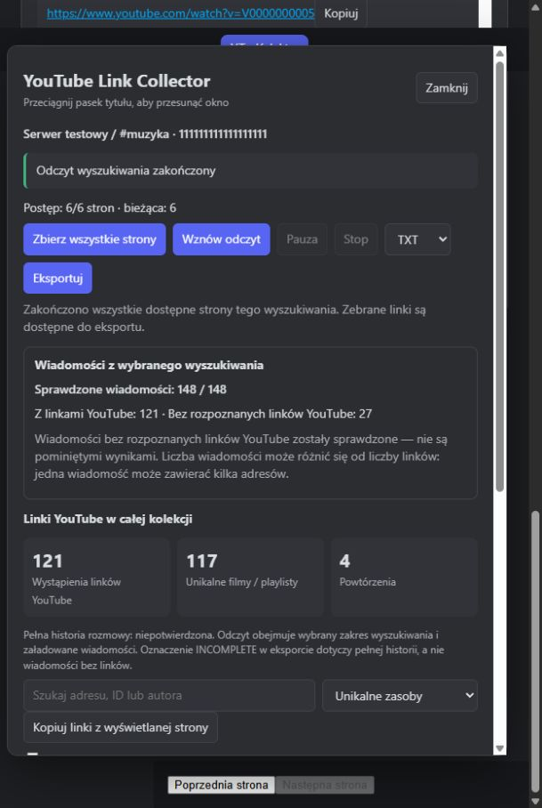

# Walidacja 1.2.5 — 2026-10-10

Autor projektu: ProGraMajster.

| Sprawdzenie | Wynik | Zakres |
| --- | --- | --- |
| Node/Windows, pełna suita | 168/168 PASS; 0 fail/skip | Parser, kolekcja, eksport, lifecycle, nawigacja, pacing, rozliczenie wiadomości i ruch okna. TEST-RESULTS.txt. |
| Dystrybucja | PASS | 9 JS i oba HTML: składnia, autor/version, brak transportu/tokenów w pluginie. |
| Rozliczenie wyszukiwania | PASS | 148 wiadomości, 121 z linkami, 27 bez linków. Odrębne niepotwierdzone odczyty, niezgodny licznik, chat poza zakresem i roundtrip. |
| Przeglądarka: podsumowanie, nawigacja, eksport | 18/18 PASS | Syntetyczne BdApi: sześć stron, pięć istniejących kliknięć, checkpoint przed click, 121 wystąpień, 117 unikatów, pełny TXT zgodnie z trybem. |
| Przeglądarka: bieżący błąd i checkpoint | PASS | Nowy błąd widoczny; odtworzenie finished przy wyzerowanym autoFinished przywraca sukces, liczniki i dawny błąd w zwiniętej historii. |
| Przeglądarka: okno | PASS | Rzeczywisty drag i ruch klawiaturą, brak aktywnego capture po ruchu, ta sama pozycja po close/open; sticky nagłówek podczas przewijania. |
| Przeglądarka: resize 480×360 | PASS | Nagłówek dostępny, x=8/right=468/bottom=352 w viewport 480×360, brak poziomego overflow; override zresetowany. |
| Checkpoint rzeczywistego klienta 1.2.4 | PASS, odczyt bez zapisu | Wszystkie 148 ID na sześciu stronach; 121/117/4 linków, 27 odczytanych bez linków, finished. Użytkownik dostarczył zrzuty natywnego klienta. |
| Aktualizacja do 1.2.5 | PASS | Plugin zgodny z plikiem źródłowym. Kopie poza paczką. Konfiguracja bajtowo niezmieniona; JSON zachował dane, historię i przerwę 1–5 s. |
| Zgodność bota | PASS | Checkpointy 1.2.0–1.2.4 odczytane przez 1.2.5. |
| Nowy interfejs 1.2.5 w natywnym Discordzie | NOT EXECUTED — environment unavailable | Agent nie ma sterowania natywnym UI; test przeglądarkowy nie stanowi tego dowodu. |
| Pełna historia / fizyczny zapis końcowego eksportu na koncie | NIEPOTWIERDZONE | Ukończenie sześciu stron nie jest dowodem pełnego archiwum; checkpoint nie potwierdza zapisu eksportu na dysk. |

[Raport](RELEASE-REPORT-1.2.5.md), [protokół natywny](MANUAL-TEST.md). Poprzednie przebiegi nawigacji/przerwy/Stop/timeout z 1.2.4 pozostają opisane w historycznym raporcie, nie jako nowe testy przeglądarkowe 1.2.5.

